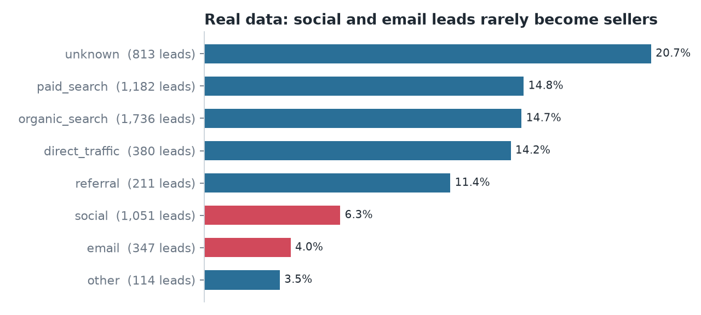
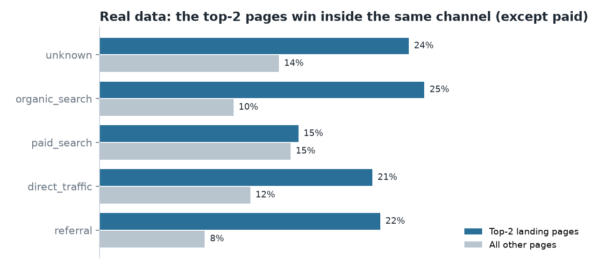
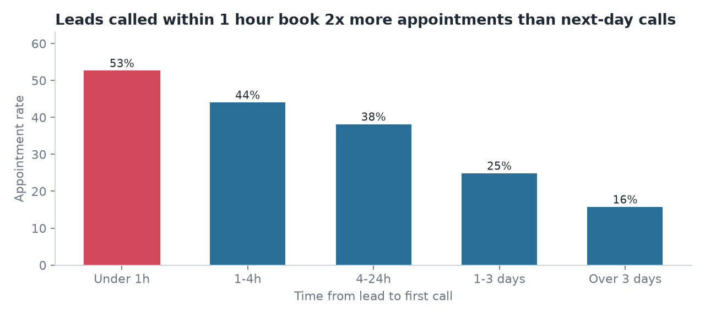
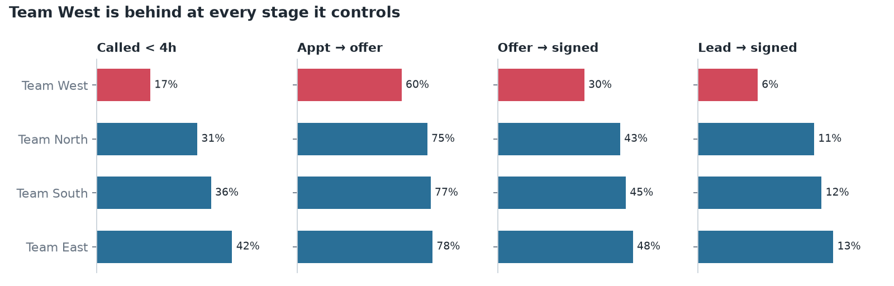

# Sales Funnel Analytics


**Live dashboard:** [sales-funnel-analytics-karan.streamlit.app](https://sales-funnel-analytics-karan.streamlit.app/) (if it's been asleep, click the wake-up button and give it a minute)

I built this project to practise the kind of work a sales or operations analyst does every week: take a messy export, figure out where customers drop out of the funnel, and turn that into a report a manager can act on. Most of the analysis is in SQL and Excel, with some Python to glue it together and a small Streamlit dashboard on top.

There are two parts:

1. **A real B2B sales funnel** from Olist (public Kaggle dataset): 8,000 leads and 842 closed deals.
2. **A residential solar funnel** that I simulated, because the data I actually wanted (call times, appointments, offers, marketing spend) is not something companies publish.

I started with the solar part, then added the Olist data so the project isn't only built on numbers I generated myself.

---

## Part 1: Olist marketing funnel (real data)

Olist is a Brazilian marketplace that recruits small businesses to sell on its platform. A business fills in a sign-up form on one of Olist's landing pages, which makes it a lead, and then a sales rep tries to sign them. The dataset covers both steps, linked by a lead id.

Before looking at any conversion numbers I ran into a problem. The deals table only starts in December 2017, but the leads go back to June 2017. So if you plot conversion by month, 2017 looks terrible (1–6%) and 2018 looks like sales suddenly tripled. That jump comes from how the data was exported, not from anything the sales team did. I limited the analysis to leads from 2018, which leaves 5,998 leads and 781 deals, about **13% conversion**. A deal takes 12 days to close at the median.

What I found:

- **Social and email leads rarely turn into sellers.** Together they make up about 23% of all leads but only 10% of deals. Social converts at 6.3% and email at 4.0%, while organic and paid search are both around 15%. If sales reps work through leads in arrival order, they spend a lot of time on these.
- **Two landing pages do much better than the rest.** They convert at 22–23%, compared with about 10% for every other page. My first thought was that they just get better traffic, so I compared pages within the same channel. The gap is still there: organic search visitors convert at 25% on those two pages vs 10% elsewhere, and referral visitors at 22% vs 8%. Paid search is the exception (15% on both), which I can't fully explain. I'd want to A/B test this before calling it, but it looks like something about the pages themselves matters.
- **A few reps carry most of the volume.** 5 of 21 sales reps closed just over half of all deals, and the top rep alone closed 16%. The data only records the rep on won deals, so I can't say who has the best win rate, only who closes the most.
- **The best "channel" is unknown.** About 14.5% of leads have no tracked source, and they convert at 21%, better than any named channel. Before moving any marketing budget around, I'd fix the tracking first.

Some other things in the data you can't trust: one deal is dated before its own lead, and about 95% of deals have a declared revenue of zero, so I didn't attempt any revenue analysis. The full list is in `sql/olist/07_olist_data_quality.sql`.

<p>


</p>

The Excel report for this part (`excel/Olist_Real_Funnel_Report.xlsx`) uses the two Kaggle tables exactly as downloaded. I did the join inside Excel with MATCH and INDEX on the lead id, so every number on the report sheets traces back to the raw rows. Change the start date on the Settings sheet and everything recalculates.

More detail: [reports/real_data_findings.md](reports/real_data_findings.md)

---

## Part 2: Solar sales funnel (simulated)

This part is modelled on how a German residential solar company sells: a lead comes in, someone calls them, they book an appointment, get an offer, sign, and eventually get the panels installed. Four regional sales teams, 24 reps, seven marketing channels, about 200 leads a week.

I generated the data with `src/generate_data.py` and made the raw export deliberately messy, the way real CRM exports usually are: 195 duplicate rows, the same channel spelled 17 different ways ("google ads", "GoogleAds", "Facebook/Instagram", "Empfehlung"...) and some missing regions. Cleaning that up is in `src/clean_data.py`.

I also built a few effects into the generator (for example, that calling a lead quickly helps) without labelling them anywhere. The point was to see whether the analysis would find them on its own, the way it would have to with real data.

For conversion rates I only used leads that were at least 8 weeks old, since a lead from last week hasn't had a chance to sign yet. That leaves 14,634 leads, and about **10% of them signed**.

What came out of it:

- **The biggest drop is between the first call and the appointment.** Only 37% of contacted leads book an appointment. Call speed makes a big difference: leads called within an hour booked 53% of the time, compared with 25% for leads that waited 1–3 days. More than a quarter of leads waited over a day.
- **One team is behind at almost every step.** Team West converts 5.6% of its leads, while the other three average 11.8%. It calls more slowly, sends fewer offers after appointments, takes about 6 days to send an offer (the others take around 3), and closes fewer of those offers.
- **Cheap leads aren't cheap customers.** Meta Ads has the lowest cost per lead (€28), but so few of those leads sign that each contract costs €616, more than Google Ads. Referrals (€166 per contract) and organic website leads (€121) are far more efficient.
- **Slow offers lose deals.** Offers sent within 3 days of the appointment close about 50% of the time. After 7 days it drops to 22%.

<p>


</p>

The Excel KPI report for this part (`excel/Solar_Funnel_KPI_Report.xlsx`) includes a weekly management sheet: 12 weeks of leads, appointments, offers and signed contracts, with week-over-week change and a 4-week average. All of it is COUNTIFS / SUMIFS on the data sheet, so you can pick a different report week on the Settings sheet and the whole thing updates. I checked that the Excel numbers match the SQL output exactly.

My recommendations and rough impact estimates are in [reports/management_summary.md](reports/management_summary.md).

---

## How it's put together

```
data/real_olist/    Olist CSVs from Kaggle (+ SOURCE.md with license info)
data/raw/           simulated solar CRM export (the messy version)
data/processed/     cleaned solar data
sql/olist/          queries on the Olist data
sql/                queries on the solar data
src/                Python scripts: generate, clean, load, run SQL, charts, Excel
excel/              the two Excel reports
dashboard/          Streamlit app
reports/            findings, management summary, charts
outputs/            SQL results saved as CSV
tests/              data checks
run_all.py          runs everything in order
```

Everything goes into a local SQLite database (`data/funnel.db`), so there's no server to set up. The SQL is mostly CTEs, CASE logic and window functions (RANK, LAG, running totals) and should port to Postgres or BigQuery with small changes.

The tests check things like no duplicate leads, stage dates in the right order, and no lead that signed without getting an offer. They also check that the dashboard calculations give the same numbers as the SQL queries. I added those after noticing how easy it is for two versions of "conversion rate" to quietly drift apart.

## Running it

You'll need Python 3.11 or newer.

```bash
git clone https://github.com/Karan6528/sales-funnel-analytics.git
cd sales-funnel-analytics
python -m venv .venv
source .venv/bin/activate          # on Windows: .venv\Scripts\activate
pip install -r requirements.txt

python run_all.py                  # takes about 25 seconds
pytest -q
streamlit run dashboard/app.py
```

`run_all.py` rebuilds the database, the SQL outputs, the charts and both Excel files from scratch.

## Things I'd do next

- Connect the Excel report to the database with Power Query, so the weekly sheet refreshes with one click instead of a re-run.
- Rebuild the dashboard in Power BI, since that's what a lot of teams actually use.
- For the solar data: check whether the call-speed effect holds within each channel, since faster calls might just mean hotter leads get called first.

## Data

The Olist data is © Olist, published on [Kaggle](https://www.kaggle.com/datasets/olistbr/marketing-funnel-olist) under CC BY-NC-SA 4.0. It's included here unchanged, for non-commercial use. The solar data is simulated by this project. The code is MIT licensed.

---

Karan Lodha, MSc Data Science, AI & Digital Business, Berlin
[LinkedIn](https://www.linkedin.com/in/karanlodha/) · [GitHub](https://github.com/Karan6528)
