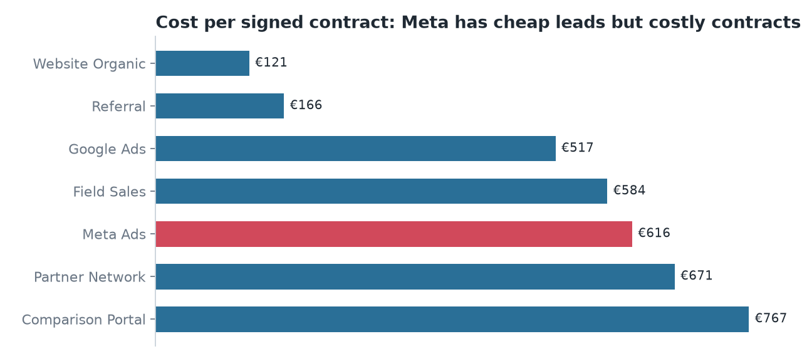

# Management Summary – Solar Sales Funnel

**Scope:** 14,634 leads created Jan 2025 – Jul 2026 (mature cohort), 7 marketing channels, 4 regional sales teams, 24 reps.
**Headline:** 10.0% of leads become signed contracts (1,469 contracts, avg. value €22,000, CAC €465).

> Data is synthetic, modelled on a German residential-solar funnel. Numbers are reproducible with `python run_all.py`.

---

## Three things management should know

### 1. The biggest leak is the first sales call, and speed fixes part of it
Of the leads we reach, only 37% book an appointment. The funnel loses 8,376 leads here, more than all other stages combined.

How fast we call matters a lot:

| Time to first call | Share of leads | Appointment rate |
|---|---|---|
| Under 1 hour | 7% | **53%** |
| 1–4 hours | 24% | 44% |
| 4–24 hours | 40% | 38% |
| 1–3 days | 27% | **25%** |

Over a quarter of leads wait more than a day. Calling them the same day (at the 4–24h rate) would add **≈470 appointments and ≈140 contracts (≈€3.2M)** on this cohort.

### 2. Team West underperforms at every step it controls
Team West converts **5.6%** of leads vs **11.8%** for the other three teams. The gap is operational, not lead quality: the leads come from the same channels.

- Calls only 17% of leads within 4 hours (others: 31–42%)
- Sends an offer to 60% of appointments (others: 75–78%)
- Takes 6.4 days on average to send an offer (others: ~3); 38% take longer than a week
- Closes 30% of offers (others: 43–48%)

Bringing Team West to the average of the other teams would mean **≈250 more contracts (≈€5.6M)**.

### 3. Judge channels on cost per contract, not cost per lead
Meta Ads delivers the cheapest leads (€28 each) but only 4.5% sign, so a contract costs **€616**, more than Google Ads (€517). Referral and organic web leads are the most efficient by far (€166 and €121 per contract; 24% of referral leads sign).

Related: offers that take more than 7 days close at **22%**, vs **50%** for offers within 3 days.

---

## Recommendations

| # | Action | Owner | Expected effect | How to measure |
|---|---|---|---|---|
| 1 | Same-day call SLA: every new lead called within 4 working hours; auto-route weekend leads to a Monday-morning queue | Inside Sales | +140 contracts / cohort | Share of leads called < 4h (weekly report) |
| 2 | Team West recovery plan: offer turnaround target of 3 days, pair with Team East for offer process, weekly review of open appointments without offer | Sales Ops + Team West lead | Up to +250 contracts | Appt → offer rate and days to offer, by team |
| 3 | Shift budget toward referral incentives and test a 10–15% cut in Meta Ads spend, tracking cost per contract, not cost per lead | Marketing | Lower blended CAC | CAC by channel, monthly |
| 4 | Add "cost per signed contract" and "days to offer" to the weekly management report | BI | Faster detection of issues | – |

**Caveats:** effects overlap (Team West's slow calls are part of finding 1), so they should not be added up. Channel budget shifts have diminishing returns and should be run as controlled tests. Recent leads (Aug–Sep 2026) are excluded from conversion rates because they have not had time to sign.
