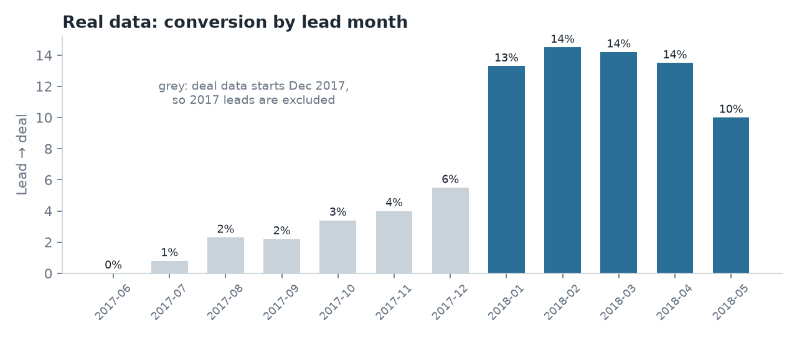
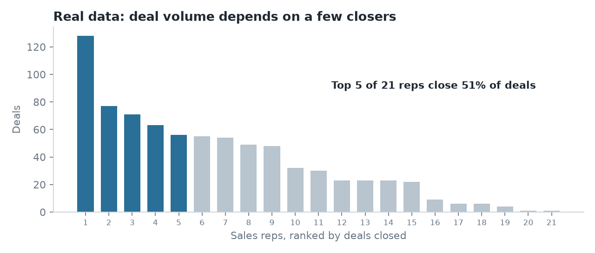

# Findings – Real Data: Olist Marketing Funnel (Kaggle)

**Scope:** 5,998 real marketing qualified leads (sellers who signed up on a landing page, Jan–May 2018) and the 781 that the sales team closed. Overall **13.0%** of leads become sellers; median time to close is **12 days**.

**Why only 2018:** the deals file starts in Dec 2017. Leads from 2017 therefore look like they almost never convert (1–6%), which is an artefact of the extract, not of sales performance. Checking this before reporting the trend avoids a false "sales tripled in 2018" headline.

---

## 1. Social and email bring a quarter of leads but few sellers
| Channel | Share of leads | Lead → seller |
|---|---|---|
| Organic search | 29% | 14.7% |
| Paid search | 20% | 14.8% |
| **Social** | **18%** | **6.3%** |
| **Email** | **6%** | **4.0%** |

Social and email are 23% of all leads but only 10% of deals. Sales reps spend qualification time on leads that convert at less than half the average.
**Action:** score social and email leads lower in the queue, or ask one extra qualifying question on those forms.

## 2. Two landing pages convert at twice the rate of all others, even within the same channel
The two highest-traffic pages convert at **22–23%**, the rest at **~10%**. Within organic search the gap is 25% vs 10%; within referral, 22% vs 8%. That means it is not just better traffic. Paid search is the exception: 15% on both.
**Action:** A/B test sending organic traffic to the best page, and review what those two pages do differently (form length, message, offer).

## 3. Five of 21 sales reps close half of all deals
The top rep alone closes 16% of deals. This is a key-person and capacity risk: if one rep leaves, deal volume drops noticeably.
**Action:** document what the top closers do and use it for onboarding; balance lead routing. Note: the data only records the rep on won deals, so this measures volume, not win rate.

## 4. Tracking gap: the best-converting source is "unknown"
14.5% of leads have origin `unknown` or empty, and they convert at **21%**, the best of any group. The business cannot see where its best leads come from.
**Action:** fix UTM / source tracking on the sign-up forms before reallocating marketing budget.

## 5. Speed: most deals close within a month
36% close within a week, 71% within 30 days, and 13% take more than 90 days. Leads open for more than 30 days are a different pipeline, worth a separate follow-up process and separate forecasting.

---

## Data quality notes
| Check | Result | Handling |
|---|---|---|
| Deals without a matching lead | 0 of 842 | Join is clean |
| Deals won before first contact | 1 | Excluded from timing |
| Declared monthly revenue = 0 | 797 of 842 (95%) | Not used: no revenue analysis possible |
| `has_company`, `has_gtin`, ... empty | ~92% | Not used |
| Rep known only for won deals | – | No per-rep win rate |
